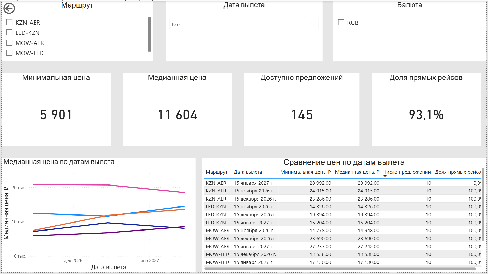
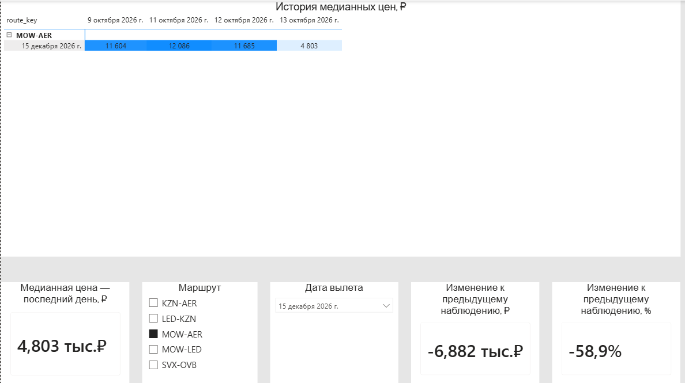

# Aviasales Analytics Kit

Аналитический проект для мониторинга цен на авиабилеты: от получения кэшированных данных Travelpayouts / Aviasales Data API до PostgreSQL и интерактивного дашборда Power BI.

## Power BI dashboard

Дашборд состоит из двух страниц:

- **Price Monitoring** — обзор доступных цен, числа предложений, доли прямых рейсов и сравнение маршрутов по датам вылета.
- **Динамика цен** — история медианных цен для выбранной комбинации «маршрут × дата вылета», последняя цена и её изменение к предыдущему доступному наблюдению.

### Price Monitoring



> Скриншот показывает пример состояния дашборда. Полный набор мониторинга включает пять маршрутов.

### Динамика цен



На странице «Динамика цен» можно выбрать маршрут и дату вылета, посмотреть историю медианных цен по датам сбора и сравнить последнее наблюдение с предыдущей доступной датой.

Основные показатели второго листа:

- медианная цена на последнюю дату сбора;
- изменение к предыдущему доступному наблюдению в рублях;
- изменение к предыдущему доступному наблюдению в процентах;
- тепловая матрица истории цен по маршрутам, датам вылета и датам сбора.

Изменения отражают динамику медианных цен доступных кэшированных предложений API, а не обязательно изменение стоимости одного и того же билета. Цвет ячеек в матрице показывает уровень цены, а не направление её изменения.

## Цель проекта

Построить воспроизводимый аналитический pipeline, который позволяет:

- регулярно получать наблюдения о ценах на авиабилеты;
- сохранять исходные ответы API без изменения;
- загружать наблюдения в PostgreSQL;
- формировать аналитическую витрину для BI;
- отслеживать цены для одинаковых комбинаций «маршрут × дата вылета»;
- анализировать доступные кэшированные цены, количество предложений и долю прямых рейсов;
- визуализировать текущую ситуацию и динамику в Power BI;
- развивать проект через dbt-трансформации, дополнительные исследования и интерфейс бота.

## Архитектура

```text
Travelpayouts / Aviasales Data API
                ↓
src/collect_price_panel.py
                ↓
data/raw/price_panel_*.jsonl
                ↓
src/load_price_panel_to_postgres.py
                ↓
PostgreSQL
  raw.travelpayouts_responses
  staging.flight_price_observations
  marts.mart_price_monitoring_daily
                ↓
Power BI
  Price Monitoring
  Динамика цен
```

Для локальной подготовки файлов и контрольного анализа также используется отдельный процесс:

```text
data/raw/price_panel_*.jsonl
                ↓
src/prepare_price_panel.py
                ↓
data/processed/price_panel.csv
```

## Возможности

- Сбор цен по фиксированному набору маршрутов и дат вылета.
- Хранение неизменённых API-ответов в JSONL с моментом сбора в UTC.
- Загрузка исходных API-ответов и распакованных наблюдений в PostgreSQL.
- Аналитическая витрина `marts.mart_price_monitoring_daily` для Power BI.
- Контроль ошибок: при неуспешном сборе загрузка в БД не запускается.
- Журналирование запусков в `logs/daily_pipeline.log`.
- Power BI-дэшборд с обзором цен и отдельным листом динамики.
- DAX-метрики для последнего наблюдения и изменения к предыдущей доступной дате.
- Отдельный EDA-ноутбук для анализа разовой исторической выборки.

## Структура проекта

```text
aviasales-analytics-kit/
├── data/
│   ├── raw/                               # локальные неизменённые API-ответы, исключены из Git
│   └── processed/                         # локальные подготовленные таблицы, исключены из Git
├── dashboards/
│   └── aviasales_price_dashboard.pbix     # рабочий Power BI-отчёт
├── docs/
│   └── images/
│       ├── price_monitoring_dashboard.png
│       └── price_dynamics_dashboard.png
├── notebooks/
│   ├── 01_environment_check.ipynb
│   └── 02_flight_prices_eda.ipynb
├── src/
│   ├── collect_price_panel.py             # сбор данных из API
│   ├── prepare_price_panel.py             # подготовка локального CSV
│   └── load_price_panel_to_postgres.py    # загрузка в PostgreSQL
├── dbt_project/                           # dbt-модели и SQL-трансформации
├── bot/                                   # код бота
├── logs/                                  # логи запусков, исключены из Git
├── run_daily_price_pipeline.bat           # ежедневный запуск сбора и загрузки
├── requirements.txt
└── README.md
```

## Быстрый старт

### 1. Клонирование

```bash
git clone [https://github.com/Filippova-Kristina-Valerianovna/aviasales-analytics-kit.git](https://github.com/Filippova-Kristina-Valerianovna/aviasales-analytics-kit.git)
cd aviasales-analytics-kit
```

### 2. Conda-окружение

```bash
conda create -n aviasales-analytics python=3.13 -y
conda activate aviasales-analytics
pip install -r requirements.txt
```

### 3. Настройка переменных окружения

Создай локальный файл `.env` в корне проекта. Он не должен попадать в Git.

```env
TRAVELPAYOUTS_TOKEN=your_token
POSTGRES_HOST=localhost
POSTGRES_PORT=5432
POSTGRES_DB=aviasales_analytics
POSTGRES_USER=postgres
POSTGRES_PASSWORD=your_password
```

Для доступа к API нужен токен Travelpayouts. Для выполнения pipeline также требуется доступный локальный экземпляр PostgreSQL.

### 4. Запуск ежедневного pipeline

В Windows из корня проекта:

```bat
.\run_daily_price_pipeline.bat
```

Скрипт:

1. создаёт `logs/`, если папки нет;
2. запускает `src\collect_price_panel.py`;
3. прекращает выполнение, если сборщик завершился с ошибкой;
4. запускает `src\load_price_panel_to_postgres.py`;
5. сохраняет ход выполнения и ошибки в `logs\daily_pipeline.log`.

Для регулярного запуска этот BAT-файл можно добавить в Планировщик заданий Windows.

## Данные и мониторинг

Панель собирает наблюдения по фиксированным комбинациям маршрутов и дат вылета. Такой подход позволяет сравнивать доступные цены во времени при неизменных параметрах поездки.

### Маршруты

- `KZN → AER`
- `LED → KZN`
- `MOW → AER`
- `MOW → LED`
- `SVX → OVB`

### Фиксированные даты вылета

- 15 ноября 2026 года;
- 15 декабря 2026 года;
- 15 января 2027 года.

На каждом запуске фиксируется время сбора `collected_at` в UTC. Пустой ответ API означает, что для комбинации маршрута и даты вылета на момент запроса не нашлось предложения в кэше; он не интерпретируется как цена 0.

## PostgreSQL и BI-витрина

Pipeline загружает данные в PostgreSQL в три слоя:

| Слой | Таблица | Назначение |
|---|---|---|
| Raw | `raw.travelpayouts_responses` | Неизменённые ответы API и метаданные запросов |
| Staging | `staging.flight_price_observations` | Распакованные ценовые наблюдения для дальнейших преобразований |
| Marts | `marts.mart_price_monitoring_daily` | Дневная аналитическая витрина для Power BI |

Витрина `marts.mart_price_monitoring_daily` содержит показатели, агрегированные на уровне маршрута, даты вылета, валюты и даты сбора, включая:

- минимальную, медианную и среднюю цену;
- количество доступных предложений;
- количество и долю прямых предложений;
- среднюю длительность;
- среднее число пересадок;
- минимальный и максимальный горизонт до вылета.

Разделение на raw, staging и marts сохраняет исходные ответы для аудита и создаёт удобный аналитический слой для BI.

## Power BI

Рабочий файл отчёта:

```text
dashboards/aviasales_price_dashboard.pbix
```

### Лист Price Monitoring

Первый лист предназначен для обзорного анализа и позволяет фильтровать данные по:

- маршруту;
- дате вылета;
- валюте.

Основные показатели:

- минимальная цена;
- медианная цена;
- число доступных предложений;
- доля прямых рейсов;
- сравнение цен по датам вылета;
- детальная таблица наблюдений.

### Лист «Динамика цен»

Второй лист предназначен для анализа выбранной поездки во времени. Пользователь выбирает маршрут и дату вылета, после чего видит:

- историю медианных цен по датам сбора;
- медианную цену на последнюю доступную дату;
- абсолютное изменение к предыдущему доступному наблюдению;
- процентное изменение к предыдущему доступному наблюдению.

Изменение всегда считается между последней и предыдущей **доступными** датами сбора. Поэтому оно не предполагает, что pipeline выполнялся строго каждый календарный день.

После нового запуска pipeline обнови набор данных в Power BI, чтобы отобразить новые наблюдения.

## EDA: разовая выборка

Первое исследование проекта доступно в ноутбуке [`notebooks/02_flight_prices_eda.ipynb`](notebooks/02_flight_prices_eda.ipynb).

Исследование рассматривает разовую выборку цен и изучает связь цены с маршрутом, числом пересадок и горизонтом бронирования. В исторической выборке было 305 предложений на 41 маршруте; период вылета — с 9 октября 2026 года по 31 января 2027 года, валюта — RUB.

### Ключевые результаты EDA

- Диапазон цен: от 4 480 ₽ до 43 772 ₽.
- Медианная цена: 14 593 ₽; средняя цена: 15 155 ₽.
- Прямые рейсы составили 83,0% выборки.
- В доступной выборке наиболее высокая медианная цена наблюдалась в когорте 90 дней до вылета — 19 640 ₽.

Эти результаты описывают одну выгрузку и не доказывают причинно-следственных связей. Для анализа динамики необходимы регулярные наблюдения, которые собирает ценовая панель.

## Ограничения данных

Aviasales Data API возвращает цены из кэша поисковой истории пользователей, а не данные о подтверждённых бронированиях. По документации Travelpayouts данные кэшируются, а срок хранения зависит от типа запроса и может составлять от 2 до 7 дней. Поэтому проект анализирует изменения доступных кэшированных цен, а не фактические продажи или рыночную цену в реальном времени. [Aviasales Data API](https://support.travelpayouts.com/hc/en-us/articles/203956163-Aviasales-Data-API)

- Пустой API-ответ не означает отсутствие рейсов или нулевую цену.
- Наличие цены не гарантирует, что предложение всё ещё доступно для покупки.
- Результаты зависят от покрытия кэша, параметров API и времени сбора.
- Изменение цены может быть вызвано изменением состава доступных предложений.
- Наблюдаемые различия между маршрутами, пересадками и датами не следует трактовать как доказательство причинности.

## Статус и следующие шаги

### Уже реализовано

- Ежедневный запуск `run_daily_price_pipeline.bat` через Планировщик заданий Windows.
- Регулярное накопление временного ряда по фиксированным комбинациям «маршрут × дата вылета».
- Загрузка данных в PostgreSQL и использование витрины `marts.mart_price_monitoring_daily` в Power BI.
- Два листа Power BI: обзорный мониторинг и динамика цен выбранной поездки.
- DAX-метрики последнего наблюдения и изменения к предыдущей доступной дате.

### В развитии

- Показатели покрытия и качества данных: успешность сборов, доля комбинаций с предложениями, свежесть загрузки.
- Формализация dbt-моделей аналитического слоя, если витрина пока создаётся не через dbt.
- Автоматическое обновление Power BI после успешного запуска pipeline.
- Подключение дополнительных источников для сравнения предложений и анализа качества маршрутов.
- Интерфейс бота для получения актуальных метрик.